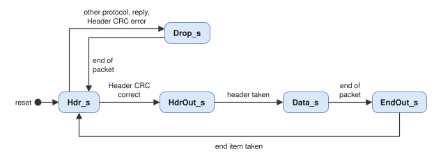

# omap_target: Architecture and Design Description

## 1. Overview

All blocks run in `Clk`. The streams between them (header, data, end of packet, memory command, write and read
bytes, reply request, reply data and reply end) have a valid / ready handshake; the authorisation answers a start
pulse two cycles later (section 3), and the memory access reports `Mem_Busy` and `Mem_Err` as levels. The
controller executes one command at a time (architecture D3).

## 2. Command decoder (TG-1, `omap_target_rx`)

The decoder counts the characters of the header. The Instruction (third character) gives the size of the Reply
Address; the fields after it are located relative to its end: Initiator Logical Address, Transaction Identifier,
Extended Address, Address, Data Length, Header CRC. The Header CRC is computed with `crcUpdate` over the header and
compared with the received byte.

| Condition | Behaviour |
| --- | --- |
| End of packet before the Header CRC | `Evt_HdrShort`, packet discarded |
| Header CRC error | `Evt_HdrCrc`, rest of the packet discarded |
| Protocol Identifier not 0x01 | Rest of the packet discarded (the core routes these packets to the user port) |
| Packet type 0b00 | `Evt_ReplyRx`, rest of the packet discarded |
| Correct header | Header to the controller; the decoder waits for the controller to take it |

After the header the decoder classifies every character. For write and read-modify-write commands with packet type
0b01 the first Data Length bytes are passed to the controller (with the Data CRC computed over them), the next byte is
compared with the Data CRC, all further characters set `End_Excess`; for all other commands every character sets
`End_Excess`. The end of packet marker gives one end item with `End_Eep`, `End_Immediate` (no character after the
header), `End_Early` (Data CRC not received), `End_Excess` and `End_CrcOk`. The data output is a register; a
character is taken when the register is free, so the end item always follows the last data byte.

## 3. Authorisation (TG-2, `omap_target_auth`)

Stage 1 evaluates every check from the header in parallel: reserved packet type, command kind, logical addresses,
key, read-modify-write length, verify buffer size, alignment of single-address accesses, AXI address range, and per
window the range and the permission. The accessed range is the memory word for a single-address access, n = Data
Length / 2 bytes for a read-modify-write and the Data Length otherwise, at least one byte. Stage 2 selects the first
failing check in the order of architecture decision D9 (2, 12, 3, 11, 9, 10). The result is valid two cycles after
`Start`.

## 4. Command controller (TG-3, `omap_target_ctrl`)

| State | Action |
| --- | --- |
| Idle | Header taken from the decoder, authorisation started, memory error flag cleared |
| Auth | Reserved packet type: Drain without reply. Failed check: Drain with the status. Otherwise Ext (`ExtAuth_g`, writes and reads) or the data state of the command kind |
| Ext | External authorisation request held until the response; rejection: Drain with status 10 below the end of packet errors |
| Drain | Rest of the packet discarded; the reply follows the end of the packet unless it ended with an EEP immediately after the header |
| WrData | Data bytes into the write buffer; chunks committed to memory (below); at the end of the packet the status of D9 |
| RdWait | End of the packet: EEP or excess data give a reply without execution; otherwise the read is started |
| RdExec, RdEnd | Reply request with status 0 and the Data Length, read data forwarded to the reply encoder, then the end of the reply: Data CRC and EOP, or EEP after a memory error |
| RmwData | Data and mask (up to 8 bytes) into registers; end of the packet checked |
| RmwExt | External authorisation after the data check (`ExtAuth_g`) |
| RmwRead, RmwWrite | Read of n bytes, new bytes (mask and data) or (not mask and read data), write of n bytes |
| Reply, RepData, RepEnd | Reply request, data of a read-modify-write, end of the reply |
| Done | Indication of a command without reply |

### Write buffer and chunks

The write buffer is an `olo_ft_fifo_sync` of `BufferBytes_g` bytes. `Received` counts the bytes written into it,
`Committed` the bytes for which a memory write command was issued. A command of one chunk is issued when that many
bytes are in the buffer and not committed; a chunk is `ChunkBytes_g` bytes, at most the largest command of the memory
access block (section 5); the remainder is issued when the last byte of the Data Length is
received. A non-verified write commits from the start, a verified write only after the end of the packet when the
Data CRC is correct and there is no excess data. After an early EOP or an EEP no further chunk is committed and the
uncommitted bytes are discarded from the buffer once every committed byte has been passed on. The bytes of a chunk are
passed to the memory access block after its command has been accepted. A single-address write commits chunks that are
multiples of the memory word (`ChunkBytes_g` and the largest command are multiples of it; the core checks
`ChunkBytes_g` at elaboration).

The command completes when the end of the packet is known, every committed byte has left the buffer, the buffer is
empty and the memory access block is idle. A memory error, or a double error of the buffer, then gives status 1 if no
other status applies.

### Indication

Every command with an intact header ends with `Ind_Valid` and the header fields, the final status and whether a reply
was sent. Commands discarded for a reserved packet type report status 2, an EEP immediately after the header
status 7, both without reply.

## 5. Memory access (TG-4, `omap_target_mem`)

`olo_ft_axi_master_full` executes commands of any byte address and length. Its user side is 8 bits wide: the master
places the write bytes of a command in their byte lanes of the AXI words and returns the read data as bytes. A
single-address command is split into one AXI command of one memory word per word of data, all at the same address.
`Busy` covers commands not yet issued or completed on AXI. `Err` is set by an error response on any write response or
read beat of a command, which the master reports at the end of the command, and by a double error in a data buffer of
the master; the controller clears it at the start of every command.

A command carries at most 2^S - W bytes (W = `AxiDataWidth_g`/8, a whole number of memory words):
`olo_axi_master_full` counts the bytes of a command in S = `AxiAddrWidth_g` - 2 bits (`AxiAddrWidth_g` - 1 at 8-bit
data, at most 24, the width of the Data Length). The controller splits a longer read into commands of this length at
the following addresses (at the same address for a single-address read) and issues the next one when the previous one
is taken; the read data and a memory error are handled as for one command (D6). The limit is one memory word below
2^S for two reasons: a single-address access is split into whole words, and no write command reaches the sizes 2^S -
W + 1 to 2^S - 1, after which `olo_axi_master_full` of Open Logic 4.7.0-ft.6 issues no write address for the next
command. Chunks and the last bytes of a write are never longer than this limit, and a read-modify-write writes at
most four bytes.

The master runs in its high-latency mode with data buffers of two bursts of `AxiMaxBeats_g` words; the buffers hold
one byte per ECC word.

## 6. Reply encoder (TG-5, `omap_target_tx`)

The Reply Address field is shifted so that its first byte is the top byte; leading 0x00 bytes are skipped until the
first non-zero byte or the last byte. The header bytes (7 for a write reply, 11 for a read or read-modify-write
reply) are sent with the Header CRC computed on the fly. A read format reply then takes `Rep_DataCount` bytes from the
data input, waits for the end input and sends the Data CRC and an EOP, or an EEP.

## 7. Resources and timing

The window comparisons of TG-2 (two 41-bit comparisons per window) are registered in stage 1. All other paths are one
level of control logic plus the CRC update (two levels of XOR).
